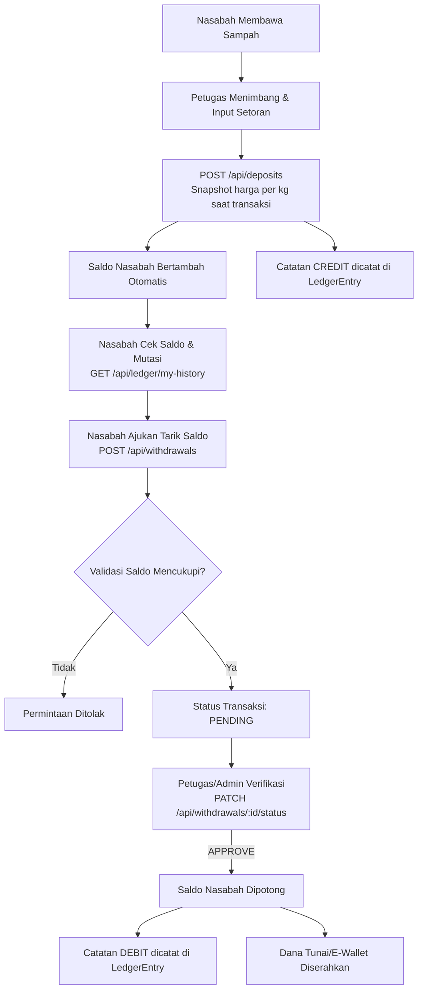

# Dokumentasi Proyek: Sistem Informasi Bank Sampah (RW 05)

Dokumentasi singkat mengenai arsitektur, alur kerja, daftar API, dan panduan instalasi proyek **Bank Sampah**.

---

## 1. Ringkasan Proyek

Sistem Informasi Bank Sampah adalah aplikasi berbasis web yang dirancang untuk mendigitalkan operasional pengelolaan sampah di tingkat komunitas/warga (studi kasus RW 05). Sistem ini menyelesaikan masalah pencatatan manual di buku fisik yang rawan salah hitung, mudah hilang/rusak, dan sulit ditelusuri riwayatnya.

### Masalah & Solusi
- **Masalah**: Pencatatan manual buku tabungan sampah memperlambat operasional saat banyak nasabah mengantre, rawan kesalahan perhitungan nominal timbangan, dan rekam jejak saldo sulit diverifikasi jika buku fisik rusak atau hilang.
- **Solusi**: Sistem otomatisasi berbasis REST API yang mencatat berat dan jenis sampah, mengonversi sampah menjadi saldo rupiah secara real-time, mendukung pencairan saldo (tunai, transfer bank, dan e-wallet), serta menyediakan buku besar (*audit trail ledger*) yang transparan dan akurat.

---

## 2. Arsitektur & Teknologi

| Komponen | Teknologi | Deskripsi |
| :--- | :--- | :--- |
| **Runtime & Server** | Node.js, Express.js (v5) | Framework REST API backend berkinerja tinggi |
| **Database & ODM** | MongoDB, Mongoose (v9) | Database NoSQL dokumen terstruktur |
| **Autentikasi & Keamanan** | JWT (`jsonwebtoken`), `bcryptjs` | Akses berbasis token bearer & enkripsi hash kata sandi |
| **DevOps & Container** | Docker, Docker Compose, Vercel | Siap dijalankan di lokal, kontainer, maupun lingkungan serverless |
| **Pengujian & API Spec** | Postman, Native Node HTTP & E2E Scripts | Koleksi pengujian otomatis siap impor |
| **Frontend (Tahap Berikutnya)** | React / Next.js | Antarmuka pengguna (klien web) |

---

## 3. Struktur Direktori

```text
BANK-SAMPAH/
├── docs/                                  # Dokumentasi dan referensi pengujian
│   ├── DOKUMENTASI.md                     # Dokumentasi singkat proyek (file ini)
│   ├── readme.md                          # Rincian arsitektur & deskripsi modul
│   ├── tugas.md                           # Rujukan spesifikasi tugas & rubrik penilaian
│   └── Bank_Sampah_Postman_Collection.json # File koleksi request API untuk Postman
├── backend/                               # Layanan REST API Backend
│   ├── api/                               # Handler serverless untuk Vercel
│   ├── src/
│   │   ├── index.js                       # Entry point aplikasi Express
│   │   ├── config/db.js                   # Konfigurasi koneksi MongoDB
│   │   ├── controllers/                   # Logika bisnis modul
│   │   ├── middleware/                    # Auth (JWT & RBAC), validasi, error handling
│   │   ├── models/                        # Skema MongoDB (User, WasteCategory, Deposit, Withdrawal, Ledger)
│   │   ├── routes/                        # Router endpoint modular
│   │   ├── utils/                         # Helper generator kode transaksi (DEP / WD)
│   │   └── seeders/seed.js                # Skrip seeding data awal
│   ├── test_e2e.js                        # Uji end-to-end logika transaksi & mutasi
│   ├── test_http_endpoints.js             # Uji HTTP endpoint otomatis
│   ├── compose.yaml & Dockerfile          # Konfigurasi kontainerisasi Docker
│   ├── package.json                       # Dependensi dan script NPM
│   └── .env.example                       # Contoh variabel lingkungan
└── frontend/                              # Folder antarmuka web (Next.js/React)
```

---

## 4. Peran Pengguna (Role-Based Access Control)

Sistem menerapkan 3 tingkatan hak akses (*role*):

1. **`admin`**:
   - Memiliki akses penuh terhadap sistem.
   - Mengelola akun pengguna (CRUD user & ubah role).
   - Mengelola master data kategori dan harga sampah per kg.
   - Menyetujui/menolak pengajuan penarikan saldo nasabah.
   - Mengakses dashboard statistik dan mengekspor rekap laporan (CSV).
2. **`petugas`**:
   - Operasional lapangan.
   - Menimbang sampah dan mencatat transaksi setoran (*deposit*) nasabah.
   - Memverifikasi dan menyetujui/menolak pencairan saldo nasabah.
   - Membaca data pengguna dan laporan rekap sampah.
3. **`nasabah`**:
   - Warga penyetor sampah.
   - Registrasi mandiri akun baru.
   - Melihat katalog harga sampah aktif.
   - Memantau saldo aktif dan riwayat setoran pribadi.
   - Mengajukan penarikan saldo (*withdrawal*) ke tunai, rekening bank, atau e-wallet (DANA, Gopay, OVO, ShopeePay).
   - Memeriksa buku tabungan (*ledger history*) untuk mutasi debit/kredit.

---

## 5. Alur Bisnis Utama



---

## 6. Ringkasan Endpoint API

Semua endpoint berlabel **Protected** membutuhkan header:
`Authorization: Bearer <jwt_token>`

### 6.1. Autentikasi (`/api/auth`)
| Method | Endpoint | Akses | Keterangan |
| :--- | :--- | :--- | :--- |
| `POST` | `/api/auth/register` | Publik | Mendaftar sebagai nasabah baru |
| `POST` | `/api/auth/login` | Publik | Autentikasi email & password, mengembalikan token JWT |
| `GET` | `/api/auth/me` | Protected | Mendapatkan data profil akun yang sedang login |
| `PUT` | `/api/auth/me` | Protected | Memperbarui profil (nama, telepon, alamat, e-wallet) |

### 6.2. Manajemen Pengguna (`/api/users`)
| Method | Endpoint | Akses | Keterangan |
| :--- | :--- | :--- | :--- |
| `GET` | `/api/users` | Admin, Petugas | Daftar seluruh pengguna (filter role & search query) |
| `POST` | `/api/users` | Admin | Menambahkan akun pengguna dengan role bebas |
| `GET` | `/api/users/:id` | Admin, Petugas | Mendapatkan detail informasi pengguna |
| `PUT` | `/api/users/:id` | Admin | Memperbarui data pengguna |
| `DELETE` | `/api/users/:id` | Admin | Menghapus akun pengguna (selain diri sendiri) |

### 6.3. Kategori & Harga Sampah (`/api/waste-categories`)
| Method | Endpoint | Akses | Keterangan |
| :--- | :--- | :--- | :--- |
| `GET` | `/api/waste-categories` | Publik | Melihat katalog jenis sampah dan harga per kg yang aktif |
| `GET` | `/api/waste-categories/:id` | Publik | Detail jenis sampah tertentu |
| `POST` | `/api/waste-categories` | Admin | Menambah jenis sampah baru beserta harga satuan |
| `PUT` | `/api/waste-categories/:id` | Admin | Memperbarui harga atau deskripsi sampah |
| `DELETE` | `/api/waste-categories/:id` | Admin | Soft-delete sampah (opsi `?hard=true` untuk hapus permanen) |

### 6.4. Transaksi Setoran Sampah (`/api/deposits`)
| Method | Endpoint | Akses | Keterangan |
| :--- | :--- | :--- | :--- |
| `POST` | `/api/deposits` | Petugas, Admin | Mencatat setoran sampah baru dan menambah saldo nasabah |
| `GET` | `/api/deposits` | Petugas, Admin | Melihat riwayat seluruh setoran sampah |
| `GET` | `/api/deposits/my-deposits` | Nasabah | Riwayat setoran milik nasabah yang sedang login |
| `GET` | `/api/deposits/:id` | Protected | Mengambil rincian invoice/transaksi setoran |

### 6.5. Penarikan Saldo (`/api/withdrawals`)
| Method | Endpoint | Akses | Keterangan |
| :--- | :--- | :--- | :--- |
| `POST` | `/api/withdrawals` | Nasabah | Mengajukan penarikan saldo (minimal Rp 1.000) |
| `GET` | `/api/withdrawals` | Petugas, Admin | Daftar permohonan penarikan saldo |
| `GET` | `/api/withdrawals/my-withdrawals` | Nasabah | Riwayat pengajuan penarikan dana milik sendiri |
| `GET` | `/api/withdrawals/:id` | Protected | Detail data pengajuan penarikan |
| `PATCH` | `/api/withdrawals/:id/status` | Petugas, Admin | Menyetujui (`APPROVED`) atau menolak (`REJECTED`) penarikan |

### 6.6. Buku Tabungan / Ledger (`/api/ledger`)
| Method | Endpoint | Akses | Keterangan |
| :--- | :--- | :--- | :--- |
| `GET` | `/api/ledger/my-history` | Nasabah | Melihat mutasi buku tabungan sendiri (debit, kredit, saldo awal/akhir) |
| `GET` | `/api/ledger/user/:userId` | Petugas, Admin | Melihat mutasi buku tabungan nasabah tertentu |

### 6.7. Laporan & Rekapitulasi (`/api/reports`)
| Method | Endpoint | Akses | Keterangan |
| :--- | :--- | :--- | :--- |
| `GET` | `/api/reports/dashboard` | Petugas, Admin | Ringkasan statistik (total nasabah, sampah terkumpul, perputaran uang) |
| `GET` | `/api/reports/waste-summary` | Petugas, Admin | Rekap volume sampah berdasarkan kategori dan berat |
| `GET` | `/api/reports/export/deposits` | Petugas, Admin | Ekspor riwayat setoran sampah ke format file CSV |
| `GET` | `/api/reports/export/ledger` | Petugas, Admin | Ekspor seluruh mutasi buku besar ke format file CSV |

---

## 7. Panduan Instalasi & Menjalankan Aplikasi

### 7.1. Prasyarat Sistem
- **Node.js** v18+ dan npm
- **MongoDB** (Lokal pada port 27017 atau MongoDB Atlas Cloud)
- **Docker & Docker Compose** (Opsional, jika ingin menjalankan via kontainer)

### 7.2. Langkah Menjalankan secara Lokal

1. **Masuk ke direktori backend**:
   ```bash
   cd backend
   ```

2. **Salin file konfigurasi lingkungan**:
   ```bash
   cp .env.example .env
   ```
   *Sesuaikan `MONGO_URI`, `JWT_SECRET`, dan `PORT` pada file `.env` jika diperlukan.*

3. **Install dependensi**:
   ```bash
   npm install
   ```

4. **Inisialisasi data awal (Seed)**:
   ```bash
   npm run seed
   ```
   *Perintah ini akan membuat akun admin, petugas, nasabah contoh, serta daftar kategori sampah bawaan.*

5. **Jalankan server aplikasi**:
   ```bash
   # Mode pengembangan (dengan auto-reload nodemon)
   npm run dev

   # Atau mode produksi
   npm start
   ```
   Server aktif secara default di `http://localhost:5000`.

### 7.3. Menjalankan Menggunakan Docker
Jika lebih memilih menjalankan menggunakan Docker:
```bash
cd backend
docker compose up -d
```
Layanan backend dan MongoDB otomatis aktif bersamaan.

---

## 8. Akun Uji Coba Bawaan (Seed Data)

Setelah menjalankan `npm run seed`, akun default berikut dapat digunakan untuk pengujian:

| Role | Email | Password | Kegunaan |
| :--- | :--- | :--- | :--- |
| **Admin** | `admin@rw05.id` | `admin123` | Kelola user, kategori sampah, rekapitulasi |
| **Petugas** | `petugas@rw05.id` | `petugas123` | Catat setoran (timbang) & konfirmasi penarikan |
| **Nasabah 1** | `budi@rw05.id` | `nasabah123` | Uji setor sampah, cek saldo, ajukan tarik saldo |
| **Nasabah 2** | `siti@rw05.id` | `nasabah123` | Uji multi-nasabah |

---

## 9. Pengujian & Evaluasi

Proyek menyediakan 3 cara pengujian:

1. **Pengujian Koleksi Postman**:
   - Impor berkas [`docs/Bank_Sampah_Postman_Collection.json`](file:///docs/Bank_Sampah_Postman_Collection.json) ke aplikasi Postman.
   - Berkas telah dilengkapi urutan request terstruktur dari login, simpan token otomatis, CRUD sampah, setoran, hingga approval penarikan.
2. **Pengujian HTTP Endpoints Otomatis**:
   ```bash
   node backend/test_http_endpoints.js
   ```
   *Menguji autentikasi, status kode HTTP, respon JSON, dan proteksi role.*
3. **Pengujian Alur Bisnis End-to-End**:
   ```bash
   node backend/test_e2e.js
   ```
   *Menguji integritas data mutasi saldo, kalkulasi subtotal setoran, dan penyesuaian ledger secara langsung ke database.*
